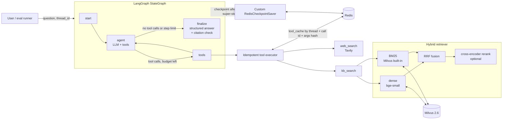

# LLM Research Agent

A multi-hop research agent built on LangGraph, with hybrid retrieval over a Milvus
knowledge base, a custom Redis checkpointer for crash recovery, and a two-layer
evaluation harness on HotpotQA.

Every number in this README comes from a recorded run. Each run directory under
`results/` has a `manifest.json` with the git commit, the full configuration
(secrets excluded), the question-set hash and library versions.

## Headline results

| | Result | Where it comes from |
|---|---|---|
| Retrieval helps the agent | EM **42.7% → 60.7%**, F1 **55.1% → 77.3%**; per question 64 wins / 10 losses | 300 HotpotQA questions, `no_retrieval` vs `dense` |
| A strong reranker helps retrieval | top-5 full-evidence recall (All@5) **78% → 93%**; 16 wins / 1 loss | first 100 questions, dense vs dense + bge-reranker |
| ...but not the end-to-end answer | 5 retrieval configs within EM 60.0–61.3%, overlapping 95% CIs | 300 questions, all retrieval configs |
| ...at a large latency cost | p50 latency **3.2 s → 15.6 s** (about 5x) | `dense` vs `dense_bge` |
| Crash recovery | **0** completed tool calls re-executed after a kill | 4 injected crash points (tests) + offline and live demos |

Conclusion for this setup: plain dense retrieval is the best default. The reranker's
retrieval gain is real, but the agent closes most of the gap by issuing several
short, rewritten queries (see [Analysis](#analysis)).

## Architecture



## What is in the box

**Agent (`src/research_agent/agent/`).** A hand-built ReAct loop
(`start → agent ⇄ tools → finalize`) rather than a prebuilt agent, so each node is a
clear checkpoint boundary and the tools node owns execution. The LLM routes between
`kb_search` and `web_search`. Answers carry inline `[S#]` citations; source ids are
stable across turns of a thread, and citations to ids that were never retrieved are
dropped and counted. A separate `short_answer` field is produced for EM/F1 scoring.
A step budget degrades gracefully: the run finalizes with the evidence gathered so
far, and unanswered tool calls are closed so the thread history stays valid.

**RAG (`src/research_agent/rag/`).** PDF (PyMuPDF), web (trafilatura) and text
loaders; a recursive splitter that measures length in the embedding model's own
tokens; deterministic chunk ids; one Milvus collection per embedding model and
chunk configuration. BM25 runs inside Milvus (2.5+ BM25 function), so there is no
separate keyword index to keep in sync. Fusion (RRF) happens in Python so every stage
(dense, BM25, fused, reranker candidates, reranked) is recorded and can be evaluated
from a single pass. Every stage can be switched off by configuration.

**Checkpointing (`src/research_agent/checkpoint/`).** A custom
`BaseCheckpointSaver` (sync and async) written against langgraph-checkpoint 4.x,
not the official Redis saver:

- channel values stored as versioned blobs; each step writes only the channels that
  changed, so storage does not grow quadratically with the message history
- pending writes follow `InMemorySaver` semantics (first-writer-wins for regular
  writes, overwrite for special writes such as `__error__`)
- keep-last-N compaction with garbage collection of unreferenced blobs
- sliding TTL refreshed on every write
- Redis Cluster hash tags (`{thread_id}`) so one thread's keys share a slot
- a deserialization allow-list (LangChain message types only); graph state holds
  only messages and JSON-native values, which is what makes the strict list possible

**Evaluation (`src/research_agent/eval/`).** HotpotQA (distractor) sampling with a
fixed seed; official EM/F1 normalization; paragraph-level and sentence-level evidence
recall; tool-trajectory metrics; bootstrap confidence intervals; per-question paired
comparisons; async runner with bounded concurrency, timeouts and resume from JSONL;
YAML ablation specs; Markdown/CSV reports and error exports.

## Results

### Setup

- **Data:** 500 questions sampled from HotpotQA distractor validation (seed 42):
  406 bridge, 94 comparison. The 10 paragraphs of every sampled question are pooled
  into one shared knowledge base of **4,955 unique paragraphs**, so retrieval has to
  find the 2 gold paragraphs among ~5,000 rather than among 10.
- **Two layers.** Layer 1 (retrieval only, no LLM) uses all 500 questions with the
  raw question as the query. Layer 2 (end-to-end agent) uses the first 300 of the
  same sample. The sample order is random, so every prefix is a uniform sample and
  smaller runs are strict subsets of larger ones.
- **Held-out dev split.** Questions 301–500 served as a development set for prompt
  debugging; no prompt was tuned for accuracy on the 300 evaluation questions. The one
  prompt change made after the evaluation started was a bug fix: the no-retrieval
  baseline's prompt still named the (unbound) tools, and the model wrote tool calls as
  plain text, so 63 of 300 `no_retrieval` questions failed to parse. The fix (a
  tool-free prompt; the prompt used with tools is unchanged) was validated on the dev
  split, and `no_retrieval` was re-run from scratch.
- **Web search is off in every evaluated run.** HotpotQA answers are on Wikipedia,
  so a web tool would measure the search engine rather than this system.
- **LLM:** requested as `deepseek-chat`; the API reported `deepseek-flash`.
  According to DeepSeek's pricing page (read 2026-10-21) this is
  DeepSeek-V4.1-Flash-1017. Non-thinking mode, temperature 0. The API's
  `system_fingerprint` was `e72d3c7f663d3e1383b00b3884cb4501` at all five checks in
  `docs/served_model.log`: during and after the six runs (the first check was about
  eight minutes after the first run started), before and after the `no_retrieval`
  re-run, and after switching the requested name to `deepseek-flash`. A fingerprint is
  the best available evidence that the backend did not change; it is not a model
  version.
- **Embeddings:** `BAAI/bge-small-en-v1.5`. **Rerankers:**
  `cross-encoder/ms-marco-MiniLM-L-6-v2` and `BAAI/bge-reranker-base`, CPU only.

### Layer 1: retrieval

Chunk sizes were chosen from the data: HotpotQA paragraphs have a median of 107
tokens (p90 204, measured on the first 2,000 paragraphs), so 64 / 128 / 256 tokens means "mostly split", "partly split" and
"almost never split" (13,369 / 7,179 / 5,166 chunks). Recall is computed per
paragraph (chunks deduplicated by title). **All@k** is the share of questions with
*every* supporting paragraph in the top k, the metric that matters for 2-hop questions.

500 questions, chunk size 128:

| stage | R@2 | R@5 | R@20 | All@2 | All@5 | All@10 |
|---|---|---|---|---|---|---|
| dense | 73.4 | 87.8 | 96.0 | 51.4 | 76.8 | 87.4 |
| BM25 | 57.7 | 73.7 | 93.7 | 27.0 | 52.2 | 74.8 |
| RRF fused | 68.4 | 86.0 | 97.1 | 42.8 | 73.2 | 89.4 |
| fused + MiniLM rerank | 70.7 | 85.5 | 97.0 | 44.4 | 71.4 | 89.4 |

First 100 questions, chunk size 128, same questions in every row:

| pipeline | R@2 | R@5 | All@2 | All@5 | All@10 | rerank ms / query |
|---|---|---|---|---|---|---|
| dense | 74.5 | 88.0 | 52.0 | 78.0 | 93.0 | – |
| fused + MiniLM | 72.0 | 86.5 | 45.0 | 74.0 | 95.0 | 680 |
| fused + bge | 81.5 | 96.5 | 65.0 | 93.0 | 97.0 | 5,295 |
| dense + bge | 83.0 | 96.5 | 67.0 | 93.0 | 96.0 | 5,289 |

Findings:

1. **bge-reranker-base is a large retrieval win**: All@5 78.0 → 93.0 over dense,
   16 questions better and 1 worse.
2. **MiniLM reranking hurts on this task.** On the 500 questions it lowers All@5
   from 76.8 (dense) to 71.4, and on bridge questions from 71.9 to 66.0. It was
   trained on single-hop web search (MS MARCO); a likely explanation is that it leans
   on surface word overlap, which penalizes the bridge paragraph that names the intermediate entity but not
   the question's terms.
3. **Equal-weight RRF hurts the top ranks when one channel is much weaker.** Dense
   is far stronger than BM25 here; fusing them lowers All@5 (76.8 → 73.2) and only
   helps deep recall (R@20 96.0 → 97.1).
4. **With a strong reranker, BM25 adds nothing measurable.** dense + bge vs
   fused + bge: All@5 93.0 vs 93.0, 2 wins / 2 losses / 96 ties. Both candidate
   pools have almost the same R@20 (98.0 vs 98.5). This holds for HotpotQA's
   full-sentence questions; corpora full of identifiers, acronyms or code are where
   BM25 is expected to matter (in a manual check on a research paper, dense missed
   the acronym "ReAct" entirely while BM25 found it).
5. **Chunk size 128 is the sweet spot**: c64 ≈ c128, c256 is clearly worse for dense
   (All@5 76.4 / 76.8 / 72.6).

Note on R@1: with 2 gold paragraphs per question, R@1 can be at most 50%. Measured
R@1 of ~45% means the top hit is a gold paragraph about 90% of the time.

Sanity checks, visible in the report: the reranker's candidate pool and the reranked
list always have identical R@20; `c128_bge` and `c128_minilm_first100` share all
pre-rerank rows exactly (retrieval is deterministic).

### Layer 2: end-to-end agent

300 questions, chunk size 128, top 5 passages per `kb_search` by default (the agent
may ask for up to 10), up to 8 steps.
EM/F1 in %, with 95% bootstrap confidence intervals. **evidence all** /
**evidence sent**: every supporting paragraph / every supporting sentence appears in
something the agent retrieved during the run.

| run | EM | F1 | evidence all | evidence sent | tool calls | latency p50 / p95 |
|---|---|---|---|---|---|---|
| no_retrieval | 42.7 [37.0, 48.3] | 55.1 | – | – | 0 | 2.4 / 4.0 s |
| dense | 60.7 [55.3, 66.0] | 77.3 | 90.7 | 88.7 | 2.24 | 3.2 / 5.5 s |
| hybrid | 60.3 [54.7, 65.7] | 76.0 | 89.0 | 87.0 | 2.18 | 3.3 / 5.6 s |
| hybrid + MiniLM | 61.3 [55.7, 67.0] | 77.9 | 89.3 | 86.7 | 2.19 | 5.1 / 9.1 s |
| dense + bge | 60.0 [54.3, 65.3] | 76.2 | 89.3 | 87.3 | 2.18 | 15.6 / 30.5 s |
| hybrid + bge | 60.3 [55.0, 65.7] | 76.5 | 91.7 | 88.7 | 2.13 | 15.2 / 29.1 s |

Per-question EM against `dense` (wins / losses / ties): hybrid 5 / 6 / 289,
hybrid + MiniLM 8 / 6 / 286, dense + bge 8 / 10 / 282, hybrid + bge 9 / 10 / 281,
no_retrieval 10 / 64 / 226.

All six runs: 300 questions, 0 errors, git-clean manifests.

Findings:

1. **Retrieval is worth +18 EM**, almost entirely on bridge questions. Comparison
   questions about two well-known entities are largely answerable from the model's
   own knowledge: bridge EM 35.8 → 57.1 (254 questions), comparison EM 80.4 → 80.4
   (46 questions).
2. **No detectable difference between the five retrieval configurations** at
   n = 300: EM 60.0–61.3 with overlapping intervals, and every per-question
   comparison within ±10. This is "not detected", not "proven equal": differences
   smaller than a few points are below what this sample can resolve.
3. **The component gain did not transfer.** bge's +15 All@5 in layer 1 shrinks to
   89–92% evidence-all for every configuration in layer 2, at about 5x latency.

### Analysis

Full output: `docs/agent_v1_analysis.md` (generated by `scripts/analyze_agent_v1.py`
from stored results; no API calls).

**Why the reranker's gain disappears.** Hypothesis: the agent issues ~2.2 short,
rewritten queries per question, and the union of their results already covers the
evidence that a better single ranking would have found. Test on a subset defined by
layer 1, independent of agent behaviour: the 16 questions (of the first 100) where
dense + bge found all evidence for the raw question and dense alone did not.

| run (16 questions) | evidence all | evidence sent | EM |
|---|---|---|---|
| dense | 75.0 | 68.8 | 62.5 |
| dense + bge | 87.5 | 81.2 | 62.5 |

With its own queries, the dense agent recovers full sentence-level evidence on 11 of
these 16 questions; bge adds evidence on 2 more, and changes the EM of none
(0 wins / 0 losses / 16 ties). This supports the hypothesis, but n = 16 is small;
treat it as supporting evidence, not a significant result. A second cut, questions
where the agent searched only once, is reported in the analysis file but is
self-selected (the agent decides when to stop), so it is not used for conclusions.

**Where the remaining errors are.** Sentence-level evidence is complete for ~89% of
questions, yet EM is ~61%. The 118 questions the dense agent got wrong (EM = 0):

| class (automatic rule) | rule | count |
|---|---|---|
| evidence not retrieved | not every supporting sentence retrieved | 22 (18.6%) |
| format / partially right | evidence complete, F1 ≥ 0.5 | 58 (49.2%) |
| "reasoning error" | evidence complete, F1 < 0.5 | 38 (32.2%) |

The third class is only what the rule labels as a reasoning error; the spot check
below shows that most of it is not. A manual spot check of 20 randomly sampled
questions from this class (seed 0,
`docs/agent_v1_label_audit.md`): **8** look like annotation or question problems,
**9** are predictions that are arguably correct but scored 0 (aliases, partial
names, and one case where the official normalization keeps the en dash in
"Denmark–Norway–Sweden"), and **3** are genuine model errors (two over-cautious
"unknown" answers, one wrong network). This was one annotator working only from the
stored records, without consulting Wikipedia, so it indicates a trend rather than
establishing ground truth. The takeaway: most of the EM gap is scoring strictness and
label noise, not retrieval, which is why F1 is the more informative headline metric.
The scorer was deliberately left as the official one so numbers stay comparable.

## Crash recovery

```bash
uv run python scripts/crash_recovery_demo.py --offline          # no API keys needed
uv run python scripts/crash_recovery_demo.py --crash-at tool:2  # live
```

The demo kills a child process with `os._exit(137)` at a chosen point, inspects Redis,
restarts on the same `thread_id` with `invoke(None, ...)`, and checks three
invariants: no tool call executed twice, the run resumed rather than restarted
(exactly one `input` checkpoint), and a final answer was produced.

Recorded runs: `docs/crash_recovery_offline.txt` (scripted LLM and fake search), and
`docs/crash_recovery_live_tool2.txt` / `docs/crash_recovery_live_agent2.txt` (DeepSeek +
Tavily, captured from the terminal on 2026-10-21, not re-run):

| crash point | external calls before crash | after resume | tool cache hits on resume |
|---|---|---|---|
| offline, `tool:2` | 2 | 1 (a new search) | 2 |
| live, `tool:2` | 2 | 0 | 2 |
| live, `agent:2` | 2 | 0 | 0 (the LLM step was redone) |

Semantics, stated precisely:

- **Completed tool calls are never re-executed.** Results are cached under
  `(thread_id, tool_call_id, hash(name, args))` as soon as the call returns. The id is
  stable across a resume because it lives in the already-checkpointed AI message.
  The args hash guards against providers that number tool calls per response.
- **A tool call that was in flight when the process died can run again** (its result
  never reached the cache).
- **LLM calls are at-least-once.** A crash after the model responds but before the
  checkpoint is written re-runs that step (the live `agent:2` demo). LLM calls have no
  external side effects, so this costs tokens, not correctness.
- Runs use `durability="sync"`: each checkpoint is persisted before the next step
  starts. With LangGraph's default async durability, a crash can lose the newest
  checkpoint; the LLM step then re-runs with new tool call ids and the cache no longer
  matches.

Why both mechanisms are needed: LangGraph's pending writes are recorded per node, and
the tools node runs every tool call of one AI message before it returns. A crash after
call 1 of 2 leaves no pending writes, so the whole node re-runs; the cache turns that
re-run into hits. The parametrized test in `tests/test_redis_saver.py` crashes at
`tool:1`, `tool:2`, `tool:3` and `agent:2` and asserts every external query ran
exactly once.

## Quick start

Requirements: Python 3.11, [uv](https://docs.astral.sh/uv/), Docker with ~8 GB RAM.
On Windows, use WSL2.

```bash
git clone <repo> && cd research-agent
uv sync
cp .env.example .env            # add DEEPSEEK_API_KEY and TAVILY_API_KEY
docker compose up -d            # Milvus 2.6 (etcd, MinIO), Redis 7, Attu
uv run python scripts/check_env.py
```

Ask questions:

```bash
uv run python scripts/ingest.py data/papers/ https://example.com/article
uv run research-agent ask -v "Were Scott Derrickson and Ed Wood of the same nationality?"
uv run research-agent chat --thread-id demo     # history persists across processes
uv run research-agent resume --thread-id demo   # finish an interrupted run
uv run python scripts/search_kb.py "your query"  # inspect every retrieval stage
```

Run the tests (no Docker or API keys needed; integration tests are opt-in):

```bash
uv run pytest -q                  # unit tests
uv run pytest -m integration      # needs the Docker services
```

Currently 74 unit tests; the 6 integration tests (Milvus) are deselected by default.

## Reproducing the evaluation

```bash
uv run python scripts/prepare_hotpot.py                               # sample + 3 collections
uv run python scripts/run_eval.py configs/ablations/retrieval.yaml    # layer 1, no LLM
uv run python scripts/run_eval.py configs/ablations/agent.yaml        # layer 2
uv run python scripts/report.py results/agent_v1 --baseline dense
uv run python scripts/analyze_agent_v1.py > docs/agent_v1_analysis.md # offline analysis
```

Re-running skips finished questions and retries failed ones; `--fresh` starts a run
over. Run the bge configurations with `--concurrency 2` on a CPU-only machine.

## Project layout

```
src/research_agent/
  agent/        graph, state, tools, prompts, factory
  rag/          loaders, chunking, embedding, Milvus store, retrieval, reranker
  checkpoint/   Redis checkpointer, key layout, serializer, tool cache
  eval/         datasets, metrics, runners, report, specs
  cli.py  config.py  crash.py
scripts/        ingest, search_kb, crash_recovery_demo, prepare_hotpot, run_eval,
                report, analyze_agent_v1, diagnose_question, served_model, check_env
configs/ablations/   retrieval.yaml, agent.yaml, agent_dev.yaml
tests/          unit tests (fakes, fakeredis) and integration tests (Milvus)
docs/           run logs, analysis, label audit, served-model log
```

## Design decisions

| Decision | Why | Trade-off |
|---|---|---|
| Hand-built `StateGraph` instead of a prebuilt agent | Clear checkpoint boundaries; the tools node owns execution, so idempotency and source numbering live in one place | More code to own |
| State holds only messages and JSON-native values | Allows a strict deserialization allow-list when reading state back from Redis | Pydantic models only at the boundaries |
| RRF in Python, not Milvus `hybrid_search` | Every stage is recorded, so one run measures each stage's contribution | Two round-trips (milliseconds locally) |
| RRF instead of score weighting | Cosine and BM25 scores are on incomparable scales; RRF needs no per-corpus tuning | Equal weights hurt when one channel is much weaker (finding 3) |
| Chunk length in the embedder's own tokens | `chunk_size` maps directly onto what the model sees; truncation is detected and reported | Tied to one tokenizer per collection |
| Title prepended to every chunk | Later chunks often never name their subject | Slightly longer chunks |
| Incremental blob storage in the checkpointer | Avoids quadratic storage as message history grows | Compaction needs blob garbage collection |
| `durability="sync"` | A crash must not lose the newest checkpoint, or tool call ids change | One extra Redis round-trip per step |
| Two-layer evaluation | Retrieval-only runs are free and cover every config; agent runs only for the few that matter | Layer-1 queries differ from the agent's own queries |
| Dev split for prompt work | Tuning prompts on evaluation questions would inflate the scores | 200 questions not used in layer 2 |
| Dense retrieval as the default | No detectable end-to-end gain from BM25 or reranking at 5x latency | Re-check on corpora with many identifiers |

## Limitations and future work

- Closed-corpus setting: the knowledge base is built from the sampled questions' own
  paragraphs, so every gold paragraph is guaranteed to be in the index. The 60.7% EM
  holds under that assumption; an open corpus where the answer may be missing would
  stress retrieval and "unknown" handling differently.
- One dataset (HotpotQA, English, Wikipedia). MuSiQue and a non-Wikipedia corpus would
  test whether the "reranker does not transfer" finding generalizes.
- 300 end-to-end questions resolve differences of roughly ±5 EM; smaller effects are
  invisible. The bge-vs-dense retrieval comparison uses 100 questions.
- EM is strict and HotpotQA labels are noisy (see the spot check). An LLM-as-judge or
  alias-aware scorer would be a useful complement; the official scorer was kept for
  comparability.
- Even at temperature 0, the same question can take a different trajectory between
  runs; differences of one or two points between runs are not meaningful.
- Rerankers ran on CPU (4 cores under WSL2); bge latency on a GPU would change the cost side of the
  trade-off, though not the finding that end-to-end accuracy did not improve.
- Multi-turn conversations resend the full history, including old tool results; long
  sessions would need context trimming.
- The served-model check relies on `system_fingerprint`, which identifies a backend
  configuration rather than a model version.
